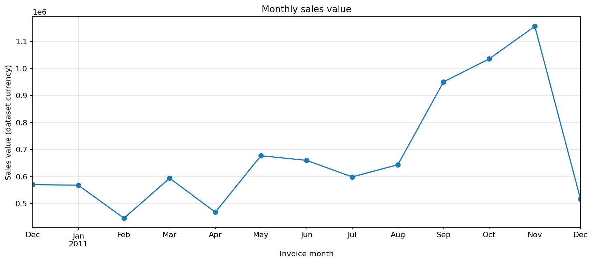
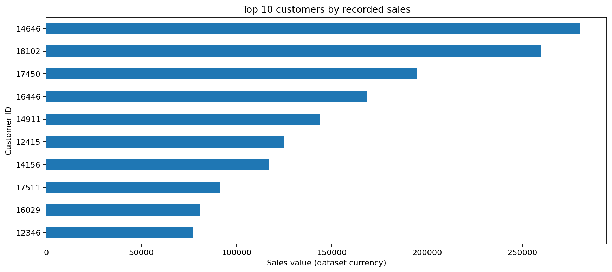
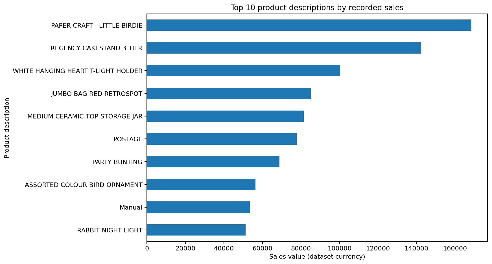
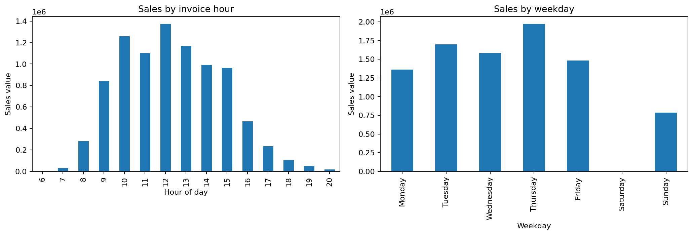
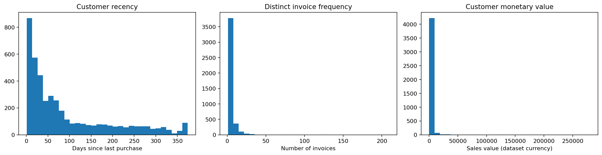
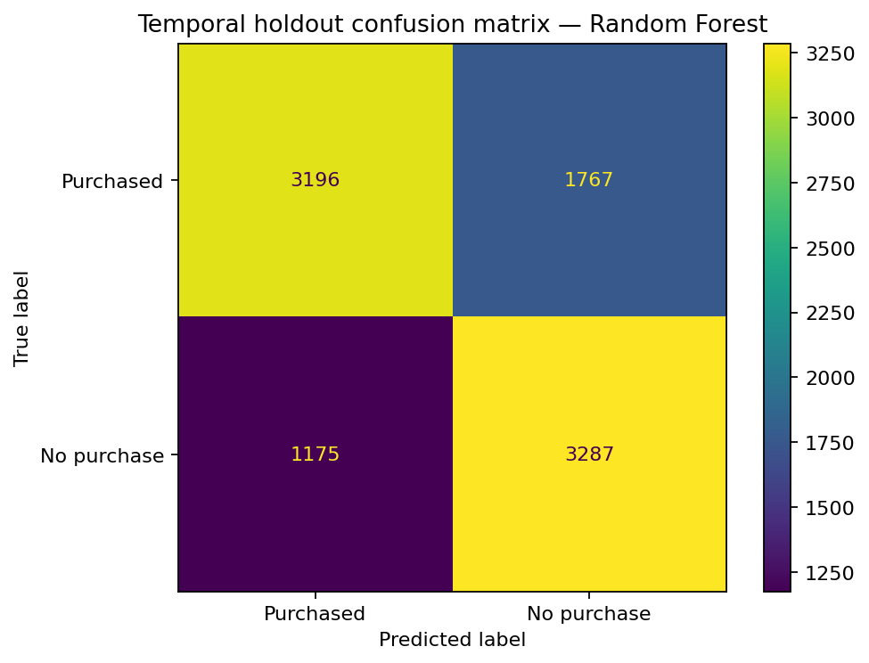
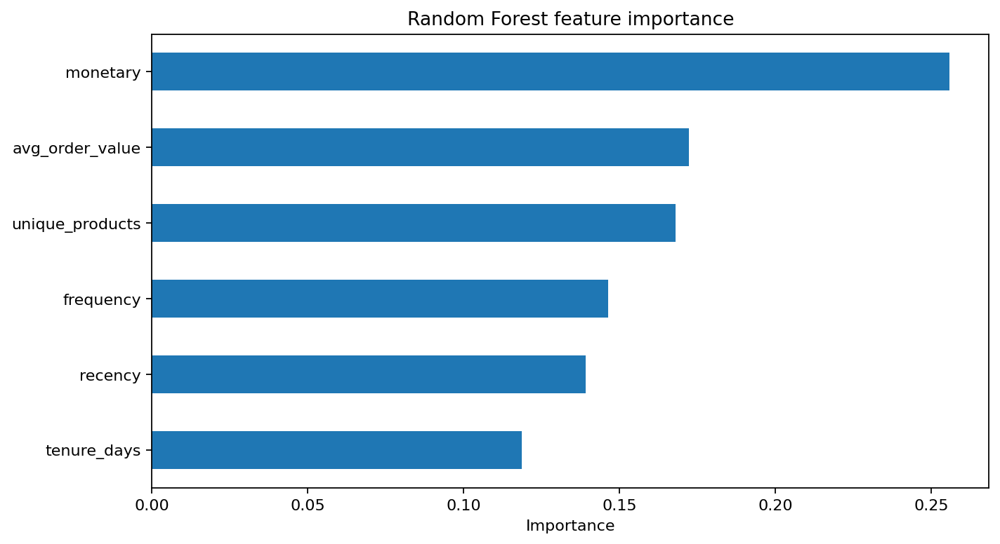

# Customer Behaviour & 90-Day Churn-Risk Analysis

**Author:** Sam Norouzi

This project analyses the UCI-style Online Retail transaction dataset to understand sales and customer behaviour, build customer-level RFM features, and test whether historical purchasing patterns help identify customers who make no purchase in the following 90 days.

## Overall Structure

The project is organised into the following sections:

1. **Data Preparation** — Cleaning the transaction dataset and preparing it for analysis.
2. **Exploratory Data Analysis** — Exploring sales trends by month, product, customer, country, hour, and weekday.
3. **Customer RFM Analysis** — Calculating Recency, Frequency, and Monetary features to understand customer purchasing behaviour.
4. **90-Day Churn-Risk Analysis** — Defining a forward-looking target based on customer inactivity during the 90 days following historical snapshot dates.
5. **Model Development** — Training and comparing Logistic Regression, Random Forest, and a majority-class baseline.
6. **Model Evaluation** — Evaluating model performance using chronological holdout testing and multiple classification metrics.
7. **Customer Risk Ranking** — Identifying active customers who may be at risk of churn.
8. **Results and Visualisation** — Presenting findings through charts, evaluation metrics, summary tables, and exported Excel workbooks.

## Project files

- `Customer_Churn_Analysis.ipynb` — End-to-end notebook with exploratory analysis, RFM summaries, forward-looking 90-day labels, time-based model evaluation, and customer risk ranking.
- `assets/charts/` — PNG charts generated automatically when the notebook runs; these are embedded below.
- `Online Retail.xlsx` — source transaction workbook.
- `customer_churn_analysis_results.xlsx` — exported RFM summary, snapshot outcome rates, model metrics, priority customers, and data-quality report.
- `high_priority_at_risk_customers_improved.xlsx` — up to 50 currently active customers ranked by the model's risk score.

Keep the notebook and source workbook in the same directory, or update `DATA_PATH` near the beginning of the notebook.

## Questions explored

1. How do sales vary by month, product, customer, country, hour, and weekday?
2. What does customer recency, distinct-invoice frequency, and monetary value reveal?
3. Can behaviour observed before a snapshot date help identify customers with no purchase in the next 90 days?
4. Which customers active near the end of the observed period should be reviewed first for retention outreach?

## Methodology

### Data preparation

The notebook reports row counts after each cleaning step. It removes exact duplicate rows, rows missing required fields, cancellation invoices (invoice numbers beginning with `C`), and rows with non-positive quantity or unit price. Sales value is calculated as `Quantity × UnitPrice`.

### Exploratory analysis and RFM

Charts and summary tables cover monthly sales, top customers, top products, country sales, and sales by invoice hour and weekday. Customer-level features include:

- **Recency:** days since last purchase at the analysis reference date.
- **Frequency:** number of distinct invoices, rather than product-line rows.
- **Monetary:** total recorded sales value.
- **Average order value:** monetary value divided by distinct invoices.
- **Tenure:** days between the first purchase and the reference date.
- **Product variety:** number of distinct stock codes purchased.

The currency is labelled “dataset currency” because the workbook does not provide a dedicated currency column.

### Forward-looking target

The predictive task is defined as **no recorded purchase during the 90 days following a historical snapshot date**. Features are computed using transactions before the snapshot date; the label is based on the subsequent 90-day window. The notebook uses multiple monthly snapshots from March to September 2011 and holds later snapshots out for testing.

This is more appropriate than defining a label from end-of-dataset recency and then training a model to reproduce that same label. However, 90-day inactivity is still a proxy outcome: a customer may return after the window.

### Models and evaluation

The notebook compares:
- A majority-class baseline.
- Logistic Regression with imputation and scaling fitted inside a pipeline.
- Random Forest.

Evaluation uses a chronological holdout and reports accuracy, churn-class precision, recall, F1, ROC-AUC, and average precision. The model is not considered production-ready; results should be interpreted in the context of the short historical dataset and the chosen 90-day definition.

### Current run: headline results

The executed notebook produced the following chronological holdout metrics:

| Model | Accuracy | Churn precision | Churn recall | Churn F1 | ROC-AUC | Average precision |
|---|---:|---:|---:|---:|---:|---:|
| Random Forest | 0.687 | 0.650 | 0.735 | 0.690 | 0.755 | 0.692 |
| Logistic Regression | 0.689 | 0.654 | 0.729 | 0.689 | 0.749 | 0.679 |
| Majority-class baseline | 0.527 | 0.000 | 0.000 | 0.000 | 0.500 | 0.473 |

These are results from this particular historical split, not a guarantee of future performance. The two trained models perform similarly, so the Random Forest should not automatically be treated as the winner merely because it is more complex.

## Requirements

Install the Python packages with:

```bash
python -m pip install pandas numpy matplotlib scikit-learn openpyxl jupyter
```

## How to run

1. Put `Customer_Churn_Analysis_Improved.ipynb` and `Online Retail(1).xlsx` in the same folder.
2. Install the dependencies.
3. Open the notebook in Jupyter Notebook, JupyterLab, or VS Code.
4. Run the notebook from top to bottom.
5. Review the metrics and exported workbooks.

The notebook writes `customer_churn_analysis_results.xlsx` and `high_priority_at_risk_customers_improved.xlsx` to its current working directory.

## Charts

The notebook saves every figure to `assets/charts/` using relative paths, so the charts can be reused in this README and viewed directly in GitHub. Run the notebook from the project root to refresh them.

### Monthly sales



### Top customers by recorded sales



### Top products by recorded sales



### Sales by invoice hour and weekday



### Customer RFM distributions



### Model confusion matrix



### Random Forest feature importance


